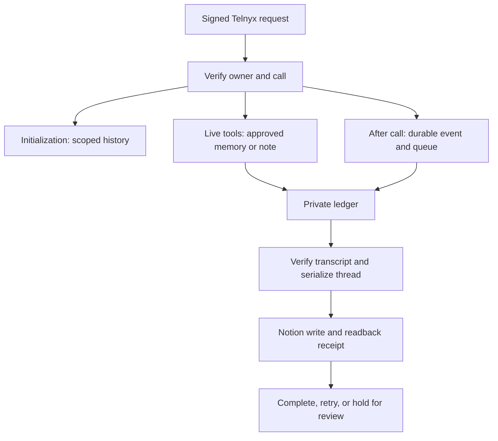

# Nia memory and call logging v2

## Release boundary

This source replaces the earlier same-number initialization pilot with a
complete relay implementation. As of the October 11, 2026 preparation session,
the relay is **not deployed**. Never describe permanent memory, the live tools,
or automatic Notion logging as active until the hosted preflight, configuration
readback, and controlled voice acceptance have passed.

## Service flow

| Component | Contract |
| --- | --- |
| `api/assistant-initialization.js` | Ed25519 over the original bytes; assistant/number/channel verification; caller-filtered history; HMAC session token. |
| `api/lookup-open-thread.js` | Signed preset fields plus call token; business/topic/location matching; fresh Notion status; reviewed non-sensitive memory only. |
| `api/save-call-note.js` | Durable idempotent request receipt; explicit `notion_saved:false`; proposed corrections and opt-outs. |
| `api/telnyx-events.js` | Signed terminal insight or conversation-ended event; durable storage and queue acknowledgment before HTTP success. |
| `api/queues/process-call.js` | Private consumer; complete transcript retrieval; frozen payload; thread serialization; verified Notion receipt. |
| `lib/ledger.mjs` | Private Blob conditional writes, stable hashed keys, leases, event/conversation deduplication, provider mutation journal. |
| `lib/notion.mjs` | Existing data-source schema; structured transcript blocks; bot-owned markers; complete content-hash readback; ambiguous-write holds. |
| `lib/deadline.mjs` | Request-local deadlines and cancellation across shared clients. |
| `scripts/import-threads.mjs` | Preview/apply of existing thread mappings and explicitly reviewed legacy call IDs; no Notion mutations. |
| `scripts/operate.mjs` | Hosted preflight, configuration preview/apply, bounded pending-work inspection, safe event redrive. |

## Truthful behavior

Nia identifies herself as Kal's AI assistant, says Kal naturally, asks one
question at a time, and listens through IVR prompts. Native keypad and quiet
tools support menus/hold. Recording stays off. Calls have a six-minute cap and
a shorter conversational/hold budget. No SMS is sent just because a call ends.

A captured message is not a booked appointment, corrected contact, sent email,
or promised human follow-up. Tool receipts distinguish private capture from
verified Notion persistence. Missing history requires clarification. Caller ID
does not prove identity. QA roleplay must not produce real outreach.

## Thread and failure rules

Callbacks linked through a verified live lookup or registered mission stay on
their original row. Original conversation ID, direction, and timestamp remain
immutable. Counts use a historical baseline plus distinct new conversations;
duplicate end/insight deliveries do not increment again. Late events retain
their transcript while preserving the newest summary and contact time.

Unmatched calls receive a separate review row. A common phone number alone
cannot merge unrelated topics. New or personal records cannot be returned by
the business lookup until they have an explicitly approved safe scope. A
different caller number receives no private history through this lookup.

An uncertain Notion write blocks later writes to that thread until its result
can be independently verified. Partial transcripts or unverified ownership
remain pending. Completion of a call never automatically closes its business
mission. The queue retries transient failures and retains a durable index for
operator review after its delivery limit; it does not silently discard a
failed save or send an unrequested notification.

See [the operations guide](docs/OPERATIONS.md) for credentials, hosting, import,
live acceptance, bounds, and the remaining manual-review cases.
